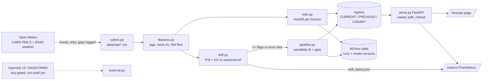

# Smogcast

Smogcast forecasts PM2.5 for Delhi NCR 24 h and 48 h ahead, and keeps an eye on its own model. The model is a plain gradient-boosted regressor, and it is deliberately simple. The project is really the platform around it: an outage-safe hourly collector, leakage-tested features, PSI/KS drift checks against a seasonally matched reference, drift-triggered retraining behind a promotion gate, a file registry with canary and rollback, MLflow tracking, a FastAPI server with Prometheus metrics, and a forecast page. The data runs to 2026-10-14 16:00 UTC. Model, replay, gate and serving numbers were re-measured on 2026-10-27 on one laptop (Intel i5-12450H, 12 logical CPUs, shared with other jobs), after deduplicating the 10 query points to the 5 distinct CAMS grid cells (see "Honest data statement"). Each number links to the file it came from. The two main findings are not flattering, and the README says so: the model beats persistence by about 10% at 24 h, and drift-triggered retraining did **not** beat blind monthly refitting.

## Headline results

| What | Result | Source |
|---|---|---|
| 24 h MAE, model vs persistence (frozen test 2025-07-01 to 2026-10-14, 5 distinct cells) | 26.4 vs 29.4 ug/m3 (MAPE 33.0% vs 39.2%) | `reports/metrics.json` |
| 48 h MAE, model vs persistence | 29.8 vs 35.8 ug/m3 (MAPE 36.7% vs 48.8%) | `reports/metrics.json` |
| Walk-forward replay, 120 weeks, 24 h MAE | static 28.11, drift-triggered 25.66, blind 28-day refit 25.31, persistence 27.50 | `reports/replay.json` |
| Drift events / retrains / promotions in replay | 39 / 14 / 9 (2 of the 9 are exact ties, see below) | `reports/replay.json` |
| p95 serving latency, `GET /predict/latest`, 1 client | 41 ms (p50 28 ms, 500 requests, 0 errors, load average 7.3) | `reports/loadtest_w1.json` |
| p95 serving latency, 8 concurrent clients | 504 ms (p50 410 ms, 19 req/s, 0 errors, load average 7.0) | `reports/loadtest_w8.json` |
| Rollback time (registry swap + `/reload` + `/health` confirms the new version) | median 0.056 s, max 0.072 s, 5 repeats | `reports/rollback_timing.json` |
| Canary split, live server, `CANARY_WEIGHT=0.2` | 186 of 1,000 forecasts (18.6%) served by the canary | `reports/canary_live.json` |
| CI gate steps run locally | 14 tests pass. v001 (identical to CURRENT v002): h24 26.357 vs 26.357, h48 29.841 vs 29.841, **PASS**, exit 0. v003: h24 26.379 vs 26.357, h48 29.847 vs 29.841, **BLOCKED**, exit 1 | `reports/gate_local_run.txt` |
| Ingest fetch success | 450/450 API calls OK (2026-10-13 to 2026-10-14) | `data/ingest_log.csv` |



## Quickstart

```
source "$ML_VENV/bin/activate" && pip install -r requirements.txt
python -m smogcast.collect && python -m smogcast.train      # fetch data (about 1 min incremental, longer from scratch), fit and register v001
uvicorn smogcast.serve:app --port 8077                       # open http://127.0.0.1:8077/
```

The demo is the page at `/`. It shows the latest 24 h and 48 h forecast for each CAMS grid cell, the current value (which is also the persistence forecast), the model version being served, and the backtest MAE against persistence for that cell. It is plain HTML and vanilla JS, with light and dark modes, and it works at phone width. The JSON behind it is at `/predict/all`. `/docs` has the full API.

## Honest data statement

- OpenAQ v3 returned HTTP 401 without an API key, and no key was available, so CPCB station data is NOT used. The code path is ready (see "Needs from you").
- The data is Open-Meteo Air Quality (CAMS model analysis, not station measurements) plus Open-Meteo weather (ERA5 archive, with gaps in boundary layer height filled from historical-forecast). It covers 2023-01-01 to 2026-10-14 16:00 UTC. The collector now drops hours after "now", because Open-Meteo returns the rest of today as CAMS forecast.
- The CAMS grid is coarse, so the 10 query points collapse to 5 distinct PM2.5 series: delhi_centre/anand_vihar/rohini are identical, dwarka/noida/gurugram/faridabad are identical, and panipat, meerut and rewari each have their own (max absolute difference 0.0 over the whole history; a test checks this). Only weather differs between points in one cell. Since 2026-10-27 only one point per cell is used everywhere (`SITES` and `CELL_MEMBERS` in `smogcast/config.py`): training, evaluation, replay, drift checks and serving. Before that, all 10 points were pooled, so the two big cells counted 3x and 4x and the old headline MAE (27.1 vs 30.2 at 24 h, kept in `reports/metrics_10points_2026-10-14.json`) was weighted towards them. The page lists the other named points under their cell.
- NASA FIRMS fire counts are NOT used (that needs a MAP_KEY). Fire-season drift shows up only indirectly, through wind direction (north-westerly fraction), temperature, wind speed and PM2.5 itself.
- Boundary layer height is about 13% missing at the first site. It is left as NaN, which gradient boosting handles natively.

## Results in detail

Per grid cell, from the frozen test period in `reports/metrics.json` (model v002, which matches `models/CURRENT`, re-scored with `--eval-only` on the 5 cells; data through 2026-10-14 16:00). MAE is in ug/m3.

| Cell (points) | 24 h model / persistence | 48 h model / persistence |
|---|---|---|
| delhi_centre (anand_vihar, rohini) | 22.9 / 24.7 | 26.1 / 30.4 |
| dwarka (noida, gurugram, faridabad) | 31.1 / 35.1 | 34.6 / 42.4 |
| panipat | 31.6 / 35.4 | 35.9 / 43.3 |
| meerut | 21.5 / 23.3 | 24.6 / 28.4 |
| rewari | 24.8 / 28.3 | 28.0 / 34.4 |

Seasonal naive (the same hour one week earlier) is far worse: 41.6 MAE at 24 h and 41.7 at 48 h.

The 24 h margin over persistence is 10.3% overall (16.6% at 48 h), and it is not uniform. Monthly skill against persistence at 24 h runs from -0.037 (2025-11, the smog peak) to 0.177 (2026-03 and 2026-04). It is near zero in 2025-12 (0.03), 2026-07 (0.02) and the partial 2026-10 (-0.003), and low in 2025-09 (0.05). So the model is a modest improvement over persistence, not a large one, and it is weakest exactly when PM2.5 matters most.

v003 was refit on the 5 deduplicated cells only. It is slightly worse than v002 at both horizons (v002 also saw the duplicate points' weather), so the gate blocked it and CURRENT stays v002. v001 and v002 were fit on the same split with the same seed and are identical.

**The walk-forward replay** (`reports/replay.json`, 120 weeks from 2024-07-01, 24 h MAE weighted by rows) was rerun on 2026-10-27 on the 5 deduplicated cells (data to 2026-10-14 16:00). The drift trigger did not beat blind periodic refitting (25.66 vs 25.31). Both beat the static model (28.11), so the benefit comes from refitting at all, not from knowing when to refit. Of 39 drift events, 14 led to a candidate model and 9 of those passed the gate. Two of the 9 passes (2025-05-26 and 2025-06-23) were exact ties: the cooldown and the gate window are both 28 days, so a candidate fit on data before the gate window can be trained on exactly the data of the model promoted 28 days earlier. Under the old strictly-better rule those two are blocked, and the drift-triggered MAE is 25.62 instead of 25.66 with 7 promotions (`reports/replay_strict_gate.json`). Either way, blind refitting wins. Two replay iterations changed the drift rules after seeing results (seasonal reference, 2-flag minimum, 28-day cooldown, strict gate; on 2026-10-27 the gate became equal-or-better), so even this comparison is tuned on the evaluation period.

**Drift events against the calendar** (`reports/drift_calendar.json` and `reports/drift_calendar_summary.json`, also shown in `reports/drift_report.html`). An event dated D covers the trailing 28-day window ending at D. The periods checked were Diwali 2024 (2024-11-01), Diwali 2025 (2025-10-20), stubble season (Oct to Nov each year) and monsoon onset (taken as June 20 to July 5). The chance rate is the share of all 120 weekly decision dates whose window overlaps that kind of period. Of the 39 events:

- 9 overlap a stubble season (23% of events, chance rate 22.5%). 4 overlap a Diwali (2024-11-04, 11-11, 11-18 and 2025-11-03; 10% of events, chance rate 6.7%). 8 overlap a monsoon onset (21%, chance rate 13.3%). 22 overlap none of them (56%, chance rate 64%).
- So stubble-season events land at exactly the chance rate. Monsoon onset is somewhat over-represented, and Diwali slightly, but with 4 to 9 events per period that is not a reliable signal.
- October, when the fire season starts, has only 1 event (2024-10-21) in two seasons. The busiest stretch is April to July 2025 (13 events: pre-monsoon heat and dust, then the monsoon).
- **Verdict: the events do not line up with the fire season any better than chance.** There are flags around Diwali and November in both years, but the detector fires all year round, so it cannot be said to detect the fire season. No fire data is used, so no causal claim is made either way.

**Pipeline pass** (`reports/pipeline_runs.jsonl`). On 2026-10-14 a dry run and then a real run each collected new data and checked drift on the 28 days to 2026-10-14 16:00 (10 points, no retrain). On 2026-10-27 a dry run without collection (`--no-collect --dry-run`) repeated the check on the 5 deduplicated cells (`reports/drift_latest.json`). The only flag was `ks:pm2_5` (D = 0.300, threshold 0.30). The largest PSI was 0.194 (temperature), under the 0.25 threshold. One flag is below the 2-flag minimum, so there was no retrain and no promotion, and CURRENT stays v002. The current PSI and KS values are exposed at `/metrics`.

## Layout

- `smogcast/collect.py` does chunked fetches with retry and backoff. It survives outages and logs every attempt to `data/ingest_log.csv`. Raw CSVs go in `data/raw/`.
- `smogcast/external.py` holds the OpenAQ v3 station fetch and the NASA FIRMS daily fire counts. Both are key-gated and not used by the model yet.
- `smogcast/features.py` builds lags, rolling stats, wind u/v, NW-flow fraction and calendar features, with targets at +24 h and +48 h. It also builds the persistence and seasonal naive baselines. Only information available at time t is used, and a test checks this.
- `smogcast/train.py` fits HistGradientBoosting (MAE loss), one model per horizon, pooled over sites. The split is frozen: train to 2025-06-30 (with a 48 h purge), test from 2025-07-01. `--eval-only` re-scores CURRENT on fresh data without registering anything.
- `smogcast/drift.py` computes PSI on wind speed, NW fraction, boundary layer height and temperature, KS on PM2.5, and error drift (model MAE vs persistence MAE). The reference is seasonally matched history.
- `smogcast/retrain.py` has the promotion gate and the walk-forward replay. Gate rule: the candidate passes if its MAE is lower than or equal to the current model's at every gated horizon (24 h and 48 h for `scripts/gate.py` and the pipeline, 24 h only in the replay). A candidate identical to CURRENT passes. The gate reports and prints the MAE per horizon, labelled; `candidate_mae`/`current_mae` in its output are the plain mean over the gated horizons.
- `smogcast/registry.py` stores versioned models with CURRENT, PREVIOUS and CANARY pointers, and handles rollback. It is the source of truth the server reads.
- `smogcast/tracking.py` writes `reports/runs.jsonl` and mirrors every run to MLflow.
- `smogcast/serve.py` is the FastAPI app: `/`, `/predict`, `/predict/latest`, `/predict/all`, `/health`, `/reload`, `/metrics`.
- `scripts/`: `pipeline.py`, `gate.py`, `rollback.py`, `rollback_timing.py`, `loadtest.py`, `data_manifest.py`, `drift_report.py`.

## MLOps pieces

| Piece | What exists | Run? (2026-10-14 first pass, 2026-10-27 re-run) |
|---|---|---|
| Experiment tracking | MLflow 3.17.1 (mlflow-skinny) with a local SQLite store at `mlflow/mlflow.db` and artifacts under `mlflow/artifacts` (gitignored). The jsonl log stays alongside it. Model versions are registered as `smogcast-pm25` (v001, v002 and v003 are MLflow versions 1, 2 and 3), and the `champion` alias follows `models/CURRENT`. `python -m smogcast.tracking --sync` backfills versions and moves the alias. Telemetry is off. | Yes. The train, eval, replay and pipeline runs are logged, all three versions are registered, and `champion` points at v002. |
| Monitoring | `/metrics` serves real Prometheus exposition through `prometheus_client`: `smogcast_request_latency_seconds` (histogram per endpoint), `smogcast_predictions_total{model_version,variant}`, `smogcast_errors_total`, `smogcast_model_info`, `smogcast_canary_weight`, `smogcast_drift_psi{feature}`, `smogcast_drift_ks_pm25` and `smogcast_drift_flagged` (read from `reports/drift_latest.json`, which the pipeline writes). `deploy/prometheus.yml` is a scrape config and `deploy/grafana/smogcast-dashboard.json` is a 9-panel Grafana dashboard (p95 latency, request rate, forecasts by version and variant, errors, PSI and KS with their thresholds, drift flag, canary share, loaded versions). | `/metrics` was scraped on 2026-10-27 and every metric the dashboard queries was present, except `smogcast_errors_total`, which only appears after the first error. No Prometheus server or Grafana is installed, so the dashboard has not been imported or rendered. |
| Canary | `python scripts/gate.py vNNN --canary` points `models/CANARY` at the candidate. If it passes, the server sends a `CANARY_WEIGHT` fraction (env var, 0 to 1) of forecasts to it. Every response reports `model_version` and `variant`. Promoting the canary clears the pointer. | Covered by a test (0, 0.2 and 1 weights). Run live on 2026-10-27 with v001 as the canary (it passes the gate as a tie): 18.6% of 1,000 forecasts went to it at weight 0.2 (`reports/canary_live.json`). The pointer was then cleared. |
| Orchestration | `scripts/pipeline.py` runs collect, drift, candidate, gate and promote, with `--dry-run` and `--no-collect`. It is plain Python, not Prefect. Schedule it with `deploy/` (systemd user timer or crontab, neither installed). | Yes, a dry run and then a real run. |
| CI gate | `.github/workflows/gate.yml` runs the tests, then gates `models/CANARY` against CURRENT on the frozen test window. | The steps were run locally. Never run on GitHub (there is no remote). |
| Data versioning | `scripts/data_manifest.py` writes the sha256, size and row count of each raw CSV to `data/MANIFEST.json`. `dvc.yaml` declares the stages but DVC is not installed. | The manifest was regenerated. DVC was not run. |
| Drift report | `scripts/drift_report.py` produces `reports/drift_report.html` with PSI/KS tables, the replay events and the calendar overlap. It is hand-rolled, not Evidently. | Yes. |
| Containers | `Dockerfile` and `docker-compose.yml` | Never built: Docker is not installed and needs sudo. |

Known limits of the gate: equal MAE passes, so a candidate that is no better still replaces CURRENT if promoted. That is deliberate (an identical retrain must not be blocked), but it means the gate guards against regressions, not for improvements. Also, the frozen-window gate is only fair between candidates trained to the same `TRAIN_END`. A model refit on all data (which the pipeline does when it promotes) has seen the test window, so its frozen-window score is in-sample. The pipeline therefore gates on the last 28 realised days, with the candidate trained only on data before that window.

## Usage

```
source "$ML_VENV/bin/activate"
python -m smogcast.collect                    # incremental update (re-fetches the last 7 days, which CAMS revises)
python -m smogcast.train                      # register a new version, write reports/metrics.json
python -m smogcast.train --eval-only          # re-score CURRENT on current data
python -m smogcast.retrain                    # walk-forward replay, about 3 min on 4 threads (5 cells)
python scripts/pipeline.py --dry-run          # one scheduled pass without promoting
python scripts/gate.py vNNN --canary          # gate, then canary; later: --promote
CANARY_WEIGHT=0.1 uvicorn smogcast.serve:app --port 8077
python scripts/loadtest.py http://127.0.0.1:8077 500 1   # writes reports/loadtest_w1.json
python scripts/rollback_timing.py http://127.0.0.1:8077 5
python scripts/drift_report.py && python scripts/data_manifest.py
python -m smogcast.tracking --sync            # MLflow backfill + champion alias
python -m pytest -q tests                     # 14 tests
```

MLflow lives in `.pydeps/` because installing it into the shared ml venv would downgrade protobuf and anyio there. To install it: `uv pip install --target .pydeps mlflow-skinny==3.17.1`. Without it, tracking falls back to jsonl only. To browse runs, use the full `mlflow` package in some other environment: `mlflow ui --backend-store-uri sqlite:///mlflow/mlflow.db`.

## Needs from you

- **OpenAQ API key** (needed for CPCB station PM2.5). Register at https://explore.openaq.org/register; the key is in your account settings. Then run `export OPENAQ_API_KEY=...` and `python -m smogcast.external openaq delhi_centre` to list nearby PM2.5 sensors. Consumed by `smogcast/external.py` (`openaq_locations`, `openaq_hours`). Without the key it exits with `OPENAQ_API_KEY is not set. Get one at ...`.
- **NASA FIRMS MAP_KEY** (needed for fire counts). Request it at https://firms.modaps.eosdis.nasa.gov/api/map_key/. Then run `export FIRMS_MAP_KEY=...` and `python -m smogcast.external firms 2025-11-01`. Consumed by `smogcast/external.py` (`firms_daily_counts`, which uses VIIRS_SNPP_SP science data by default and the Punjab+Haryana bounding box). It fails the same clear way without the key.
- With both keys, the remaining work is to add a station target and a fire-count feature and PSI column, then rerun train and replay. That has not been done, because there is no data to validate it against.
- Season-long ingestion uptime requires installing the timer (`deploy/`) and leaving it running through Oct to Nov.
- Docker/k3s/BentoML and a GitHub remote for the CI run need sudo or an account.

## Not done

- **Prefect, DVC, Evidently, BentoML, k3s:** skipped. Plain-script and file-based equivalents stand in (see the table above). These tools add install weight but no new numbers on this machine, and k3s/Docker need sudo.
- **Grafana and Prometheus servers:** not installed. The dashboard JSON and scrape config exist (`deploy/`) but were never loaded into a running Grafana or Prometheus.
- **Data sources:** no OpenAQ/CPCB data, no FIRMS fire counts, no opencity CSV mirrors.
- **Uptime:** ingestion uptime over a season has not been measured. The fetch success rate above covers 2 days only.
- **Load test conditions:** the load test ran on a shared, busy machine (load average about 7, recorded in each loadtest file). Other jobs were running at the same time, so treat the latency numbers as noisy. The 8-client numbers show the sync endpoints and the GIL serialising work, not a tuned deployment.
